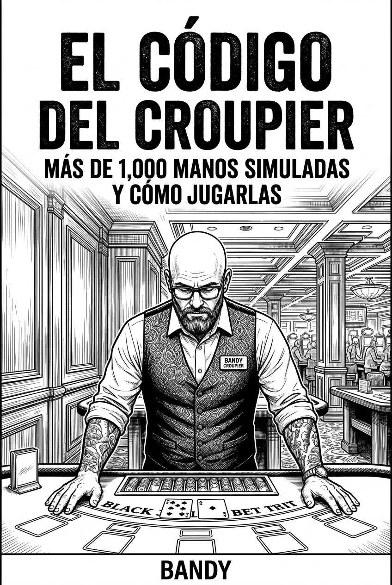

# blackjack-mit-simulator
Algoritmo en Python y consultas en SQL para la simulación transaccional y cacería de amenazas de fraude en plataformas de juego masivo.
---

## 📖 Publicación Oficial / Official Publication: *El Código del Croupier*

  

### 🇪🇸 Español
Este repositorio de simulaciones cuantitativas respalda mi libro publicado oficialmente en Amazon Kindle:

* **📘 Título:** *El Código del Croupier: Más de 1,000 manos reales simuladas en Python y cómo jugarlas con Estrategia Básica y el Sistema Hi-Lo*
* **✍️ Autor:** Bandy Barczi (Ex-Supervisor de Apoyo Operativo & Analista de Datos Operativos)
* **🔗 Disponible en Amazon Kindle:** [Ver libro en Amazon (ASIN: B0HRYK6927)](https://amazon.com)

**¿Qué conecta este repositorio con el libro?**
* **Mecánica Real de Mesa:** Traducción de procedimientos operativos reales de casino (estándar europeo/SCJ y americano) a reglas lógicas auditables.
* **Simulación Reproducible en Python:** Modelado estadístico de más de 1,000 manos reales para validar la Estrategia Básica y el conteo Hi-Lo.
* **Gestión de Riesgo y Control:** Enfoque analítico orientado a la prevención de desviaciones, auditoría de patrones y toma de decisiones basada en datos.

---

### 🇬🇧 English
This quantitative simulation repository supports my officially published book on Amazon Kindle:

* **📘 Title:** *El Código del Croupier: Over 1,000 Real Hands Simulated in Python and How to Play Them with Basic Strategy and the Hi-Lo System*
* **✍️ Author:** Bandy Barczi (Former Gaming Floor Operations Support Supervisor & Operational Data Analyst)
* **🔗 Available on Amazon Kindle:** [View Book on Amazon (ASIN: B0HRYK6927)](https://amazon.com)

**How this repository connects to the book:**
* **Real Table Mechanics:** Translating actual casino floor operating procedures (European/SCJ & American standards) into auditable logic rules.
* **Reproducible Python Simulation:** Statistical modeling of over 1,000 real hands to validate Basic Strategy and Hi-Lo card counting.
* **Risk Management & Auditing:** Analytical approach focused on deviation prevention, pattern auditing, and data-driven decision-making.
